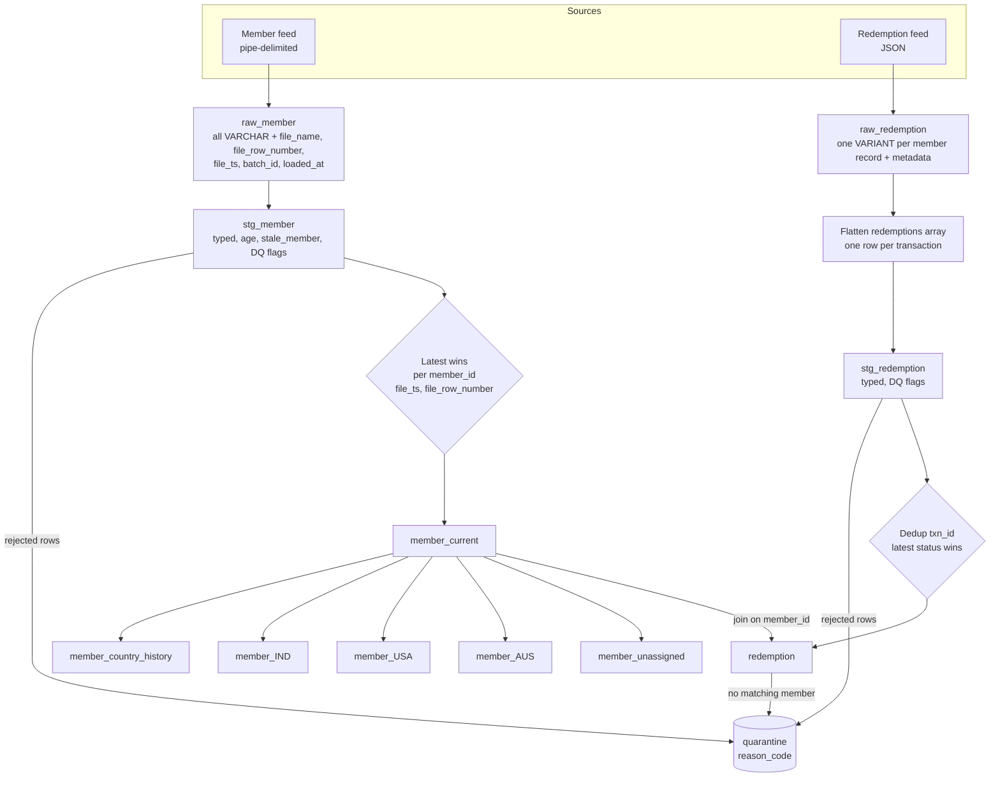

# Architecture

Daily pipe-delimited member feed + JSON redemption feed -> per-country member tables, a flattened
redemptions table, and a quarantine table. Production target is Snowflake (`sql/snowflake`); the
runnable local target is DuckDB (`sql/duckdb`, `src/skypoints`). Both implement the same layers and
the same rules, so the DuckDB run is a working model of the Snowflake design.

## Decisions taken (from review)

| Question | Decision |
|---|---|
| Member identity | `member_id` alone. IND/USA/AUS sample files are extra sources of the same feed; their ID collisions are a logged DQ finding, not modelled. |
| Latest record | Highest `file_ts`, then highest `file_row_number`. |
| Member moves country | Row is deleted from the old country table; move history is kept in `member_country_history`. |
| Redemption re-sent | Latest status wins per `txn_id` (by `feed_date`, then arrival order). Redemptions with no matching member are kept with `member_matched = false` and also flagged in quarantine. |

Assumptions carried over from `notes/initial-understanding.md`: DOB is month-first; unreadable or
ambiguous dates become NULL and are flagged, never guessed; blank/unknown country goes to
`member_unassigned`; every date calculation takes an explicit `as_of`.

## Layers

| Layer | Tables | Contents | Rule |
|---|---|---|---|
| Landing / raw | `raw_member`, `raw_redemption` | Every field `VARCHAR` (redemptions: one `VARIANT` per file record) plus load metadata | Append-only, never altered |
| Staging | `stg_member`, `stg_redemption` | Typed columns, derived `age` and `stale_member`, DQ flags | Typing happens only here |
| Conformed | `member_current`, `member_country_history`, `redemption` | One row per member; one row per transaction | Latest-wins applied here |
| Target | `member_ind`, `member_usa`, `member_aus`, ..., `member_unassigned` | Current members split by country | Rebuilt from `member_current` |
| Quarantine | `quarantine` | Rejected rows, original payload, reason code | Nothing is dropped silently |

### Raw load metadata

Added to every raw row, none of it taken from the file content:

| Column | Meaning |
|---|---|
| `file_name` | Source file |
| `file_row_number` | 1-based row in the file, excluding the header |
| `file_ts` | File date/time, from the file name or object metadata (never `now()`) |
| `batch_id` | Identifier of the load run, shared by all files loaded in it |
| `loaded_at` | Wall-clock time of the load, for audit only; never used in business logic |

### Staging

- Parses each field from text; a failed parse sets the typed column to NULL and sets a flag, the
  raw value stays in raw.
- `age` = whole years between `dob` and `as_of`; NULL if `dob` is NULL.
- `stale_member` = `last_flight_date` is NULL or older than 90 days before `as_of`. A missing flight
  date counts as stale, and that choice is written down as an assumption.
- DQ flags, one boolean per check: `dob_invalid`, `enrollment_date_invalid`, `flight_date_invalid`,
  `country_unknown`, `tier_unknown`, `id_missing`, `id_short` (warning only).
- A row is **rejected** (goes to `quarantine`) only for faults that stop it being a member: missing
  `member_id`, or a header/column-count mismatch. Bad dates and unknown country are **flagged**, and
  the row still flows on, so a member with a bad date is not lost.

### Quarantine

| Column | Meaning |
|---|---|
| `quarantine_id` | Surrogate key |
| `source_table`, `file_name`, `file_row_number`, `batch_id` | Where the row came from |
| `reason_code` | e.g. `MISSING_MEMBER_ID`, `HEADER_MISMATCH`, `INVALID_JSON`, `UNMATCHED_MEMBER`, `DUPLICATE_TXN_OLDER` |
| `reason_detail` | Human-readable text |
| `raw_payload` | The row exactly as received |
| `quarantined_at` | Load time (audit only) |

Row counts must reconcile: `raw rows = staged rows + quarantined rows` for every batch, and the
pipeline fails the batch if they do not.

## Flowchart



## "Latest record wins"

1. Take every staged member row from all batches loaded so far (staging is a stable, typed view of
   raw, so a late-arriving older file cannot overwrite a newer record).
2. Rank rows per `member_id` by `file_ts DESC, file_row_number DESC` and keep rank 1:

   ```sql
   QUALIFY ROW_NUMBER() OVER (
       PARTITION BY member_id
       ORDER BY file_ts DESC, file_row_number DESC
   ) = 1
   ```

   (DuckDB supports `QUALIFY` too.)
3. The result is `member_current`. Ties on both keys cannot happen: `file_row_number` is unique inside
   a file and two files cannot share `file_ts`; if they do, the load fails on a uniqueness check
   rather than choosing arbitrarily.
4. Rows with a NULL `member_id` never reach this step; they are in quarantine.

Because the rule only reads raw/staging and is a pure ranking, re-running the whole pipeline on the
same files gives the same `member_current`.

## Removing a member from the old country table

The country tables are **not** updated by deleting from one and inserting into another. They are
derived from `member_current`, which has exactly one row per member, so a member can only be in one
country table at a time.

- **Local DuckDB:** each country table is rebuilt in a single transaction:
  `DELETE FROM member_<c>` then `INSERT ... SELECT ... FROM member_current WHERE country = '<c>'`.
  A member whose country changed is simply absent from the old selection.
- **Snowflake:** `MERGE` has no `WHEN NOT MATCHED BY SOURCE`, so the delete is driven by a change
  set. A CTE compares the new `member_current` with the previous one (via a stream on it) and lists
  `(member_id, old_country, new_country)` where the country differs. In one task run, those members
  are deleted from the old country table, and `member_current` rows are `MERGE`d (insert/update) into
  their new country table.
- **History:** when the change set finds a country change, one row is appended to
  `member_country_history (member_id, old_country, new_country, effective_file_ts, batch_id)`. The old
  country table keeps no trace of the member; history is read from this table or raw.
- **Check:** after each run, `SELECT member_id FROM (all country tables) GROUP BY member_id HAVING
  COUNT(*) > 1` must return nothing, and the sum of country table row counts must equal
  `member_current`.

## Redemption flow

1. **raw_redemption:** each member record from the JSON loaded as one `VARIANT` (DuckDB: `JSON`) plus
   the load metadata. If the file is not valid JSON, the whole file goes to quarantine as
   `INVALID_JSON`.
2. **Flatten:** `LATERAL FLATTEN(input => payload:redemptions)` in Snowflake, `UNNEST(json_extract(...))`
   in DuckDB. A member with an empty `redemptions` array produces no transaction rows (and is not an
   error).
3. **stg_redemption:** types `txn_date` and `feed_date` (`YYYYMMDD`), `miles_redeemed` (integer),
   validates `status` against `COMPLETED` / `PENDING` and flags `miles_redeemed <= 0`,
   `txn_date > feed_date`, and an unknown status. Values keep their raw text alongside.
4. **Dedup:** the same `txn_id` can arrive again with a new status. Keep the row with the highest
   `feed_date`, then highest `file_ts`, then `file_row_number`; older versions stay in staging and the
   dropped ones are recorded in `quarantine` as `DUPLICATE_TXN_OLDER` so they are not lost silently.
5. **redemption (conformed):** left join to `member_current` on `member_id`.
   - Match: `member_matched = true`, plus the member's country and tier.
   - No match: row is kept with `member_matched = false` **and** a row in `quarantine` with
     `UNMATCHED_MEMBER`, so it can be re-joined once the member shows up. Redemptions are re-joined on
     every run because `member_matched` is computed from the current `member_current`, not stored at load.

## Snowflake vs local DuckDB

| Concern | Snowflake (production) | DuckDB (local) |
|---|---|---|
| Landing | Internal/external stage + `COPY INTO raw_member` with `FILE_FORMAT` (pipe, all `VARCHAR`), `METADATA$FILENAME`, `METADATA$FILE_ROW_NUMBER`, `METADATA$FILE_LAST_MODIFIED`; Snowpipe/auto-ingest for continuous load | `read_csv(..., all_varchar = true)` / `read_json` from `data/raw` with the metadata columns added in Python |
| `file_ts` | `METADATA$FILE_LAST_MODIFIED` or a timestamp in the file name | Parsed from the file name or file mtime |
| Redemptions | `VARIANT` column, `LATERAL FLATTEN` | `JSON` column, `UNNEST` |
| Incremental processing | Streams on raw tables + Tasks (or Dynamic Tables) so each run only touches new files; staging is incremental, not a full re-scan | Full rebuild each run; fine at sample scale |
| Latest wins | Incremental `MERGE` into `member_current` keyed on `member_id`, comparing `(file_ts, file_row_number)` so an old file cannot overwrite a newer row | `QUALIFY ROW_NUMBER()` over all staging rows |
| Country tables | `MERGE` driven by a country-change set (see above); clustering by `member_id`; one table per country is fine for tens of countries, but a single table partitioned by `country` plus per-country secure views is the better design once countries are many | Delete + insert in one transaction |
| Scale (billions of rows per day) | Multi-cluster warehouse sized per task, files split into 100-250 MB compressed chunks for parallel `COPY`, clustering keys on `member_id` / `file_ts`, `member_current` stays one row per member so its size is bounded by member count not by feed volume | Single process, in-memory |
| Quarantine | Written by the same SQL; `COPY ... ON_ERROR = CONTINUE` plus `VALIDATE()` capture file-level rejects; table is a clustered append-only table | Same table shape, written from Python |
| Raw retention | Raw is cheap and immutable; keep it for replay and audit, apply a retention policy and Time Travel for recovery | Files stay in `data/raw` |
| Orchestration & dates | Task graph passing `as_of` as a parameter; no `CURRENT_DATE()` in transformations | `--as-of` CLI argument |
| Access control | Role-based access, row access / secure views per country | n/a |
| Idempotency | Batch tracked by `batch_id` in a control table; a re-run of the same file set deletes and reloads that batch only | Whole database rebuilt |

## Open items, with answers from the notes

See `docs/adr/` for the decisions behind this design.

- **Post Code (spec has 11 columns, sample header has 10):** the header is checked against the spec and
  the file fails if it does not match, rather than parsing by position (`docs/data-quality-findings.md`).
  Still to confirm with the spec owner whether Post Code is really missing.
- **Country-code mapping:** `PHIL`, `AU` and the other mixed codes map to ISO-3 through the
  `country_code_map` lookup table (ADR 0006). Unmapped or blank country goes to `members_unassigned`.
  The contents of the map still need confirming.
- **Stale_Member:** measured from the `as_of` date passed in, not today's date. The notes do not say
  what a missing flight date means; this design treats it as stale. To confirm.
- **`file_ts`:** taken from the file name (ADR 0003); a file with no parseable timestamp is rejected.
