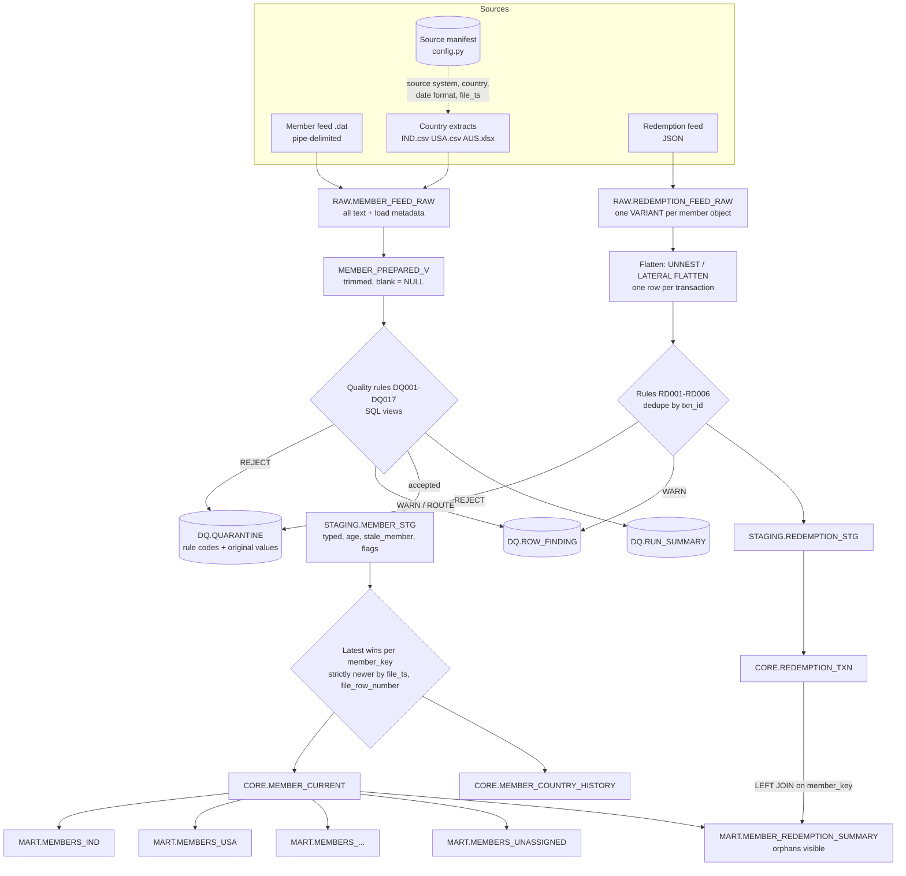

# Architecture

Daily pipe-delimited member feed + JSON redemption feed (+ three country extracts) -> per-country
member tables, a flattened redemption table, a member redemption summary, a quarantine table with
reason codes, and a data-quality report. Production target is Snowflake (`sql/snowflake/`); the
runnable local target is DuckDB (`sql/duckdb/`, `src/skypoints/`). Both implement the same layers
and the same rules. The DuckDB version is what the tests run; the Snowflake SQL is the production
design and is reviewed, not executed, here (ADR 0001).

## Decisions in one table

| Question | Decision | ADR |
|---|---|---|
| Business key | `member_key = source_system:member_id`, not Member Name and not the bare `member_id` | 0002 |
| "Latest" record | Highest `file_ts` (from the file name), then `file_row_number`; replaces the current row only if **strictly** newer | 0003 |
| Member changes country | `member_current` is updated; country tables are rebuilt from it, so the member leaves the old table | 0004 |
| Dates | DOB assumed MMDDYYYY; ambiguous or invalid dates become NULL plus a finding, never guessed | 0005 |
| Country routing | Config-driven (`REF.COUNTRY_CODE_MAP`); unknown or blank country goes to `MEMBERS_UNASSIGNED` | 0006 |
| One table per country | Delivered as asked; the cheaper alternative at scale is described | 0007 |
| Redemption feed format | A JSON array is read today; line-delimited JSON is the recommendation at scale | 0008 |

## Layers

| Layer | Objects | Contents | Rule |
|---|---|---|---|
| Raw | `RAW.MEMBER_FEED_RAW`, `RAW.REDEMPTION_FEED_RAW` | Every member field as text (a redemption member object as one `VARIANT`/`JSON`) plus load metadata | Append-only, never altered; a file already loaded is skipped |
| Staging | `STAGING.MEMBER_STG`, `STAGING.REDEMPTION_STG`, view `STAGING.MEMBER_PREPARED_V` | Typed columns, derived `age` and `stale_member`, DQ flags | Typing happens only here |
| Data quality | `DQ.QUARANTINE`, `DQ.ROW_FINDING`, `DQ.RUN_SUMMARY` | Rejected rows with original values; warnings; failures per rule | Nothing is dropped silently |
| Conformed | `CORE.MEMBER_CURRENT`, `CORE.MEMBER_COUNTRY_HISTORY`, `CORE.REDEMPTION_TXN` | One row per `member_key`; one row per `txn_id`; every country move | Latest-wins applied here |
| Mart | `MART.MEMBERS_<ISO3>`, `MART.MEMBERS_UNASSIGNED`, view `MART.MEMBER_REDEMPTION_SUMMARY` | Current members per country; redemption totals per member | Rebuilt from CORE |
| Reference | `REF.COUNTRY_CODE_MAP` | Raw country spelling -> ISO-3 | Config, not code |

Raw load metadata, added to every raw row and never taken from the file content: `file_name`,
`file_row_number` (the header is line 1), `file_ts` (from the file name, or the manifest, never
`now()`), `batch_id` (one batch per file), `loaded_at` (audit only, never used in logic).

## Flowchart

## Pipeline

`python -m skypoints.pipeline --as-of 2024-01-15` (see the README). Per run:

1. Create the schema from `sql/duckdb/` (idempotent).
2. Classify every file in `data/raw`: the **source manifest** (`src/skypoints/config.py`) first,
   then the feed name patterns; anything else is listed in the report as `no matching feed rule`.
3. Members and country extracts, oldest `file_ts` first, **one batch per file**: load to raw ->
   quality rules and staging -> merge into `member_current` -> country split. Splitting per batch
   is what records each country move in order.
4. Redemption feeds: load to raw -> flatten, validate, stage -> promote to `CORE.REDEMPTION_TXN`.
5. Print the run report (files, rows per layer, rows per country table, DQ summary by rule,
   quarantined rows) and write the CSV export (`skypoints.export`).

A file rejected whole (a header that does not match, or an invalid name) is reported as failed,
nothing of it reaches raw, and the exit code is 1.

## Data quality

Rules are SQL views (`sql/duckdb/05_validations.sql`, Snowflake twin `sql/snowflake/05_validations.sql`);
Python only loads their inputs and reads their findings, so the same logic ports to Snowflake. Config
(tiers, active values, max age, country map, lengths, date formats per source) is data, not code.

| Severity | What happens |
|---|---|
| REJECT | The row goes to `DQ.QUARANTINE` once, with every rule code that rejected it, and stays out of staging |
| WARN, ROUTE | Recorded in `DQ.ROW_FINDING`; the row is still staged (ROUTE sends it to the unassigned table) |
| FAIL_FILE | That file only is stopped (header missing a mandatory column, unknown or duplicate column) |
| FAIL_BATCH | Promotion from staging to CORE is blocked; raw is untouched |

Rules DQ001-DQ003 mandatory fields, DQ004 duplicate key inside a file (last kept), DQ005 length,
DQ006-DQ009 dates, DQ010 country, DQ011-DQ013 tier / active flag / id length, DQ014 header,
DQ015-DQ016 reconciliation of raw against staging, DQ017 country resolved through an alias.
Reconciliation: `raw rows = staged + quarantined` for every batch (DQ015), and no text column may
lose non-blank values between raw and staging (DQ016), which catches the lost `Agent_Name` of the
brief's staging example.

`stale_member` is TRUE when the last flight is more than 90 days before `as_of`, FALSE otherwise,
and NULL (unknown) when there is no flight date or it is after `as_of`. `age` is whole years at
`as_of`: the month-day comparison is the birthday adjustment (`DATEDIFF('year')` alone counts year
boundaries and is wrong for a 31 December birthday).

## "Latest record wins"

`merge_member_current` (`sql/duckdb/transform/30-32`, Snowflake `CORE.MERGE_MEMBER_CURRENT`):

1. Keep one record per `member_key` in the batch:
   `QUALIFY ROW_NUMBER() OVER (PARTITION BY member_key ORDER BY file_ts DESC, file_row_number DESC) = 1`.
2. Compare it with the `CORE.MEMBER_CURRENT` row: insert if new; **update only if strictly newer** by
   `(file_ts, file_row_number)`; ignore if older (a late-arriving old file cannot overwrite a newer
   record); do nothing if equal (re-running is idempotent).
3. Two different records with the same `(file_ts, file_row_number)` for one member raise an error
   and nothing is written; identical ones collapse silently.
4. A batch with an open FAIL_BATCH finding is refused.

## Removing a member from the old country table

The country tables are never edited one by one. They are derived from `CORE.MEMBER_CURRENT`, which has
exactly one row per member, so a member is in exactly one country table.

- **DuckDB:** each `MART.MEMBERS_<ISO3>` is rebuilt (delete and insert) in the same transaction as the
  merge; tables are created from `REF.COUNTRY_CODE_MAP`, so a new country needs no code change.
- **Snowflake:** a stream on `CORE.MEMBER_CURRENT` and a task: old images of changed members are deleted
  from every country table, new images are inserted where they now belong
  (`sql/snowflake/04_country_split.sql`).
- **History:** every country change against the previous CORE state adds one row to
  `CORE.MEMBER_COUNTRY_HISTORY`; a first appearance is not a move; unassigned counts as a value; several
  moves inside one batch collapse to one.
- **Check:** every `member_key` in CORE is in exactly one country table, and none holds a key that is
  not in CORE.

## Redemptions

1. **Raw:** each member object of the JSON is stored whole as `JSON`/`VARIANT` with the load metadata.
2. **Flatten:** DuckDB `read_json_objects` + `UNNEST`; Snowflake `LATERAL FLATTEN(payload:redemptions)`. One
   row per transaction, every value as text (a `member_id` of `007890` keeps its zeros). A member with
   an empty `redemptions` array gives no rows but is recorded (RD001).
3. **Validate and stage:** RD002 duplicate `txn_id` (newest by feed_date, file_ts, position wins; the older
   one is quarantined, not lost), RD003 negative miles, RD004 unknown status, RD005 `txn_date` after
   `feed_date` (flag only), RD006 unreadable required value.
4. **Promote** to `CORE.REDEMPTION_TXN`, one row per `txn_id`, replaced only by a strictly newer version.

### Joining redemptions back to members

- **Key:** the join is on `member_key` (`SKYPOINTS:<member_id>`), text on both sides. A numeric cast would
  lose leading zeros, and the bare `member_id` also exists in the IND, USA and AUS extracts as a different
  person. Redemptions join to the **member feed** ids only.
- **Where:** to `CORE.MEMBER_CURRENT`, not to the country tables. One join, and the member's current
  country comes with it; a country mart can expose redemptions through a view over the summary.
- **Orphans:** `MART.MEMBER_REDEMPTION_SUMMARY` starts from the transactions (`LEFT JOIN`), so a redemption
  whose member has not arrived shows `member_matched = false` with no name or country. Nothing is dropped.
  The view is computed on read, so the row resolves itself when the member shows up (late-arriving
  dimension) without any re-load.
- **Country at transaction time:** the summary shows the member's country **now**. If the business needs the
  country when the redemption happened, `CORE.MEMBER_COUNTRY_HISTORY` already has the dated moves; a full
  history of other attributes would need an SCD Type 2 member dimension (a future extension).
- **Totals:** `TOTAL_COMPLETED_MILES` and `PENDING_MILES` (0 when none), `TXN_COUNT`, and
  `LAST_REDEMPTION_DATE` (latest `txn_date` over all statuses).
- **At scale:** cluster `CORE.REDEMPTION_TXN` by `member_key`, and keep the promotion a `MERGE` on `txn_id`.

## Snowflake vs local DuckDB

| Concern | Snowflake (production) | DuckDB (local, tested) |
|---|---|---|
| Landing | Stage + `COPY INTO` with `METADATA$FILENAME` / `METADATA$FILE_ROW_NUMBER`; Snowpipe for continuous load | Python loaders insert parsed rows |
| `file_ts` | A timestamp in the file name (`YYYYMMDD_HHMMSSTT`) or `METADATA$FILE_LAST_MODIFIED` | Parsed from the file name, or fixed in the manifest |
| Redemptions | `VARIANT`, `LATERAL FLATTEN` | `JSON`, `read_json_objects` + `UNNEST` |
| Latest wins | `MERGE` keyed on `member_key`, incremental | `UPDATE` + `INSERT` in a transaction (DuckDB 1.1.3 has no `MERGE`) |
| Country tables | Stream on `MEMBER_CURRENT` + task, only changed members | Rebuilt in the same transaction |
| Rules | Same views, work tables are transient tables | Same views, in-memory work tables |
| Idempotency | File name in `LOAD_HISTORY`; `batch_id` per file | A file name already in raw is skipped |

See `docs/scaling-in-snowflake.md` for the billions-per-day story.

## Open items and assumptions

- **Post Code:** the spec lists 11 columns, the sample header has 10. The parser maps columns by header name; a
  missing optional column is a warning (DQ014), a missing mandatory one fails the file.
- **Manifest values:** the fixed `file_ts` / `feed_date` of the client extracts in `config.py` are
  placeholders (2024-01-15) until the real delivery times are known.
- **Country map and member id length:** the seed map and the "shorter than 6 is suspicious" threshold are
  assumptions to confirm with the data owner.
- **IND "Individual or Corporate":** outside the spec, not stored.
- **Linking** the IND/USA/AUS members to the master member feed is out of scope (ADR 0002).
